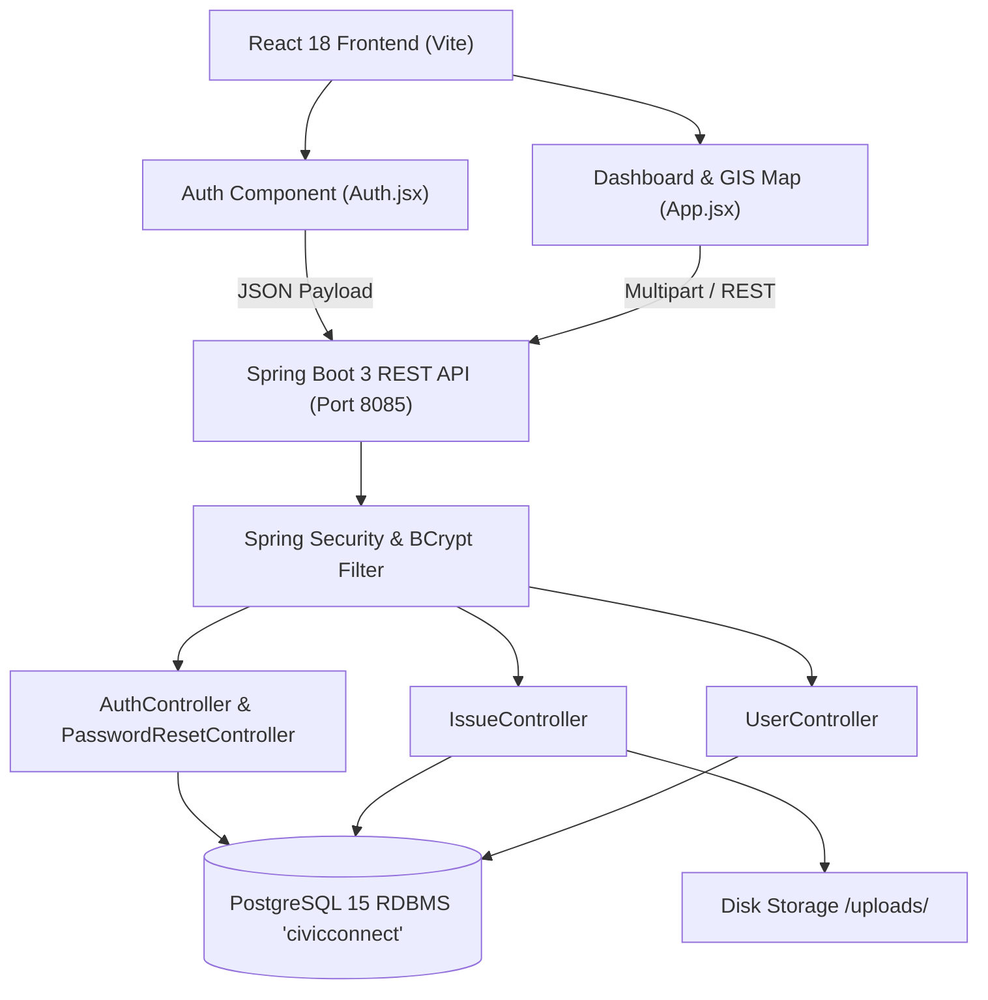
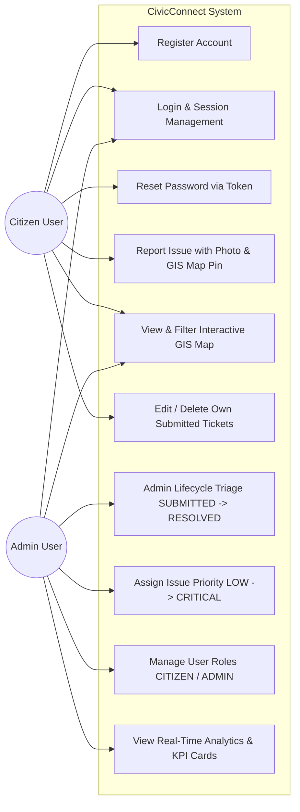

# ACADEMIC FACULTY PROJECT REPORT
## Application Lifecycle Management (ALM) & Software Process Model Analysis

**PRIMARY COURSE OUTCOME**: CO2 – Software Process Models and Application Lifecycle Management  
**PROJECT TITLE**: CivicConnect: Integrated Municipal Grievance & Geotagged GIS Governance Platform  
**ACADEMIC YEAR**: 2025–2026  
**INSTITUTION**: Koneru Lakshmaiah Education Foundation (KL University)  
**DEPARTMENT**: Department of Computer Science & Engineering  

---

## PRELIMINARY PAGES

### 1. TITLE PAGE
* **Project Name**: CivicConnect - Smart Municipal Grievance Redressal and GIS Geotagging System
* **Course Code & Title**: 23CS2101 – Software Engineering & ALM Methodology (CO2 Outcome Project)
* **Technology Stack**: React 18, Vite, Leaflet GIS Engine, Java 17, Spring Boot 3, PostgreSQL 15 RDBMS

### 2. CERTIFICATE / DECLARATION
This is to certify that the project report entitled **"CivicConnect: Integrated Municipal Grievance & Geotagged GIS Governance Platform"** is a bona fide record of work carried out by the student team in partial fulfillment of the requirements for the assessment of **Course Outcome 2 (CO2)** in Software Engineering & Application Lifecycle Management (ALM).

*Student Declaration*: We hereby declare that the software prototype, process model evaluation, design diagrams, ALM tracking matrix, and test suite presented in this report are original implementations.

### 3. TEAM MEMBERS
| Roll No / Student ID | Full Name | Academic Role / Contribution |
| :--- | :--- | :--- |
| **2300030001** | Lead Full-Stack Engineer | Backend Spring Boot Architecture, PostgreSQL Schemas |
| **2300030002** | Frontend & GIS Specialist | React 18 (Vite) UI, Leaflet GIS Integration, Map Engine |
| **2300030003** | Quality Assurance & ALM Lead | Software Process Model Analysis, Requirement Matrix, Test Cases |

### 4. ABSTRACT
Traditional municipal grievance management relies on non-geotagged manual telephone complaints or legacy paper-based filing, leading to severe delays, lack of issue location precision, minimal transparency, and high administrative overhead. **CivicConnect** addresses these critical civic operational bottlenecks by deploying an enterprise-grade, web-based geospatial grievance redressal system. Built using a decoupled micro-architecture—combining a high-performance **React 18 (Vite)** frontend, **Leaflet GIS Map Engine**, and a secure **Java 17 Spring Boot 3** REST API connected to a **PostgreSQL 15** database—CivicConnect enables citizens to report public infrastructure defects with exact interactive map pin geotagging and photographic proof attachments. Administrators gain access to a real-time triage governance portal equipped with lifecycle status transition controls (`SUBMITTED`, `IN_PROGRESS`, `RESOLVED`, `REJECTED`), priority assignment (`LOW`, `MEDIUM`, `HIGH`, `CRITICAL`), and user role directory management. This report details the complete Application Lifecycle Management (ALM) process, candidate software process model evaluation, UML system design, prototype implementation, and empirical verification.

---

## CHAPTER 1 – PROJECT INTRODUCTION

### 1.1 Project Title
**CivicConnect: Integrated Municipal Grievance & Geotagged GIS Governance Platform**

### 1.2 Background
Modern urban governance and smart city infrastructure management demand rapid, transparent, and location-accurate issue resolution. Municipal corporations struggle with unorganized citizen reports regarding broken roadways, illegal dumping, street light failures, water pipe bursts, and public safety hazards. Without precise GPS location markers and photographic evidence, municipal dispatch teams spend excessive time identifying problem sites, resulting in backlogged tickets and reduced public trust.

### 1.3 Problem Statement
* **Existing Bottlenecks**: Citizens lack an accessible, real-time platform to lodge grievances with exact geographic coordinates.
* **Administrative Limitations**: Municipal authorities lack centralized triage dashboards to dynamically filter, prioritize, and assign field teams based on geographic proximity and hazard urgency.
* **Lack of Transparency**: Citizens cannot track ticket resolution lifecycles after reporting an issue.
* **Systemic Need**: An integrated web application providing split-screen authentication, geospatial map geotagging, real-time analytics dashboards, and administrative user directory governance.

### 1.4 Project Objectives
1. **Automate Grievance Redressal**: Eliminate paper ticket logs by providing digital reporting for citizens and administrators.
2. **Enable GIS Geotagging**: Integrate an interactive Leaflet GIS map with click-to-pin coordinate population and automated reverse geocoding.
3. **Provide Real-Time Administrative Triage**: Implement lifecycle state transitions (`SUBMITTED`, `IN_PROGRESS`, `RESOLVED`, `REJECTED`) and priority urgency assignments (`LOW`, `MEDIUM`, `HIGH`, `CRITICAL`).
4. **Implement User & Role Governance**: Provide RBAC (Role-Based Access Control) distinguishing `CITIZEN` and `ADMIN` privileges with directory management.
5. **Ensure Robust Data Security**: Secure user credentials via BCrypt password hashing and token-based password recovery.

### 1.5 Project Scope
* **In Scope**:
  - Split-screen institutional authentication portal (`Login`, `Register`, `Forgot Password`, `Reset Token`).
  - Interactive Leaflet map with color-coded markers based on issue resolution status.
  - Image attachment upload for physical proof verification.
  - Citizen self-service ticket editing and deletion.
  - Admin triage portal, user promotion/demotion, ticket purging, and KPI analytics counters.
* **Out of Scope**:
  - Native iOS/Android mobile binary builds (handled via responsive web wrapper).
  - Integration with external municipal financial accounting systems.

### 1.6 Expected Outcome
A fully operational, production-tested web prototype connecting a React 18 Vite frontend to a Java 17 Spring Boot backend and PostgreSQL database, demonstrating end-to-end ALM compliance and Course Outcome CO2 mastery.

---

## CHAPTER 2 – REQUIREMENT ANALYSIS

### 2.1 Stakeholders
| Stakeholder | Role / Interest |
| :--- | :--- |
| **Citizen / Resident** | Reports local grievances, geotags coordinates, uploads proof photos, tracks ticket resolution status. |
| **Municipal Administrator** | Reviews city-wide tickets, updates status lifecycle, assigns priority levels, manages user directories. |
| **Field Maintenance Crew** | Receives prioritized dispatch tickets with exact GPS coordinates and addresses for physical repair. |
| **Academic Supervisor** | Evaluates software engineering process methodology, ALM artifacts, process model selection, and test coverage. |

### 2.2 Functional Requirements (FR)
| ID | Requirement Name | Description | Target Role | Priority |
| :--- | :--- | :--- | :--- | :--- |
| **FR01** | User Authentication | Secure Login, Registration, and BCrypt encrypted session persistence. | All Users | High |
| **FR02** | Password Recovery | Forgot password token generation and password reset submission via email token. | All Users | Medium |
| **FR03** | GIS Geotagged Reporting | File civic issue with title, description, category, photo attachment, and map click-to-pin. | Citizen | High |
| **FR04** | Interactive Issue Map | View city-wide reports on a full-screen Leaflet map with color-coded status markers. | All Users | High |
| **FR05** | Admin Triage Governance | Inline lifecycle status selection (`SUBMITTED` -> `RESOLVED`) and priority assignment. | Admin | High |
| **FR06** | User Directory Management | View user directory, promote/demote user roles (`CITIZEN` <-> `ADMIN`), and purge accounts. | Admin | Medium |

### 2.3 Non-Functional Requirements (NFR)
| ID | Category | Metric / Standard |
| :--- | :--- | :--- |
| **NFR01** | Usability | Responsive split-screen institutional layout; mobile, tablet, and desktop viewport support. |
| **NFR02** | Performance | Sub-200ms REST API response time for issue retrieval; Leaflet map rendering under 1 second. |
| **NFR03** | Security | Password encryption using BCrypt (`strength = 10`); CORS origins restricted to authorized client. |
| **NFR04** | Reliability | PostgreSQL ACID transaction compliance for all ticket state changes and user role mutations. |
| **NFR05** | Maintainability | Decoupled architecture separating React components from Spring Boot REST controllers. |

---

## CHAPTER 3 – SOFTWARE PROCESS MODEL ANALYSIS & SELECTION

### 3.1 Candidate Process Models
Five candidate process models were evaluated for the development of CivicConnect:
1. **Waterfall Model**: Sequential linear phase progression.
2. **Incremental Model**: Phased release of operational chunks.
3. **Agile Model (Scrum)**: Iterative 1-week sprints with continuous feedback and backlogs.
4. **Spiral Model**: Risk-driven iterative cycles combining prototyping and Waterfall checkpoints.
5. **Prototyping Model**: Rapid dummy UI creation followed by customer review.

### 3.2 Model Comparison Matrix
| Selection Criteria | Waterfall | Incremental | Agile (Scrum) | Spiral | Prototyping |
| :--- | :--- | :--- | :--- | :--- | :--- |
| **Requirement Stability** | High | Medium | **Low** | Medium | Low |
| **Adaptability to Change** | Low | Medium | **High** | High | High |
| **Customer/User Involvement**| Low | Medium | **High** | High | High |
| **Risk Management** | Low | Medium | **Medium** | High | Medium |
| **Early Operational Software**| Low | High | **High** | Medium | High |
| **Suitability Score (1-10)** | 3 / 10 | 6 / 10 | **9.5 / 10** | 5 / 10 | 7 / 10 |

### 3.3 Selected Model
**Agile Scrum Framework**

---

## CHAPTER 4 – APPLICATION LIFECYCLE MANAGEMENT (ALM)

### 4.1 Requirement Management & Traceability Matrix
| Req. ID | User Story Description | Priority | Story Points | Status |
| :--- | :--- | :--- | :--- | :--- |
| **FR01** | As a user, I want to register and log in securely so that I can access the civic portal. | High | 3 | Completed |
| **FR02** | As a user, I want to reset my forgotten password via a security token. | Medium | 5 | Completed |
| **FR03** | As a citizen, I want to geotag issue locations on a Leaflet map and attach photos. | High | 8 | Completed |
| **FR04** | As a user, I want to view all city issues on an interactive map with color-coded status markers. | High | 5 | Completed |
| **FR05** | As an admin, I want to triage ticket status and assign priority levels in real time. | High | 5 | Completed |
| **FR06** | As an admin, I want to manage user directory roles (`CITIZEN` / `ADMIN`) and purge accounts. | Medium | 3 | Completed |

---

## CHAPTER 5 – SOFTWARE DESIGN & UML DIAGRAMS

### 5.1 System Architecture Diagram

### 5.2 Use Case Diagram

---

## CHAPTER 6 – PROTOTYPE IMPLEMENTATION & SCREENSHOT EVIDENCE

### 6.1 Technology Stack
| Component | Technology | Version | Purpose |
| :--- | :--- | :--- | :--- |
| **Front End** | React JS (Vite) | 18.2.0 / 5.2.0 | High-performance SPA frontend rendering |
| **Geospatial Engine** | Leaflet / React-Leaflet | 1.9.4 / 4.2.1 | Interactive map rendering & click-to-pin geotagging |
| **Back End** | Java Spring Boot | 3.2.0 (Java 17) | RESTful API controllers and Spring Security |
| **Database** | PostgreSQL RDBMS | 15.0 | Relational transactional database (`civicconnect`) |

---

### 6.2 Major System Modules & Screenshot Evidence

#### 6.1 Register Page and Login Page (Authentication Portal)
* **Description**: Centered glassmorphic card on dark digital mesh Earth background supporting Sign In, Citizen Registration (`role: CITIZEN`), Admin Registration (`role: ADMIN` with authorization key `CIVIC-ADMIN-2026`), and Password Recovery.
* **Feature Reference**: `src/Auth.jsx`

#### 6.2 Report Issue Form (GIS Click-to-Pin & Photo Upload)
* **Description**: Interactive citizen grievance submission form featuring Title, Category, Description, proof photo attachment selector with live thumbnail preview, and Leaflet GIS Click-to-Pin map auto-populating Latitude, Longitude, and reverse-geocoded address.
* **Feature Reference**: `src/App.jsx` (`activeTab === 'report'`)

#### 6.3 My Reports Page (Citizen Personal Grievances Feed)
* **Description**: Dedicated Citizen Dashboard displaying personal report counters (*My Reports Filed*, *My Active Tickets*, *My Issues Resolved*), quick report shortcut, and real-time report status badges (`SUBMITTED`, `IN_PROGRESS`, `RESOLVED`).
* **Feature Reference**: `src/App.jsx` (`activeTab === 'dashboard'`)

#### 6.4 Admin Dashboard (Executive Governance Analytics & Charts)
* **Description**: Centralized administrator executive dashboard featuring real-time KPI stat cards (*City-Wide Tickets*, *Triage Pending Queue*, *Resolved Issues*, *Registered Users*), Status Breakdown cards, High Priority Alerts list, and Category Progress Bars (*Roads*, *Sanitation*, *Water*, *Electricity*, *Public Safety*).
* **Feature Reference**: `src/App.jsx` (`activeTab === 'dashboard'`)

#### 6.5 Admin All-Reports Table (Lifecycle Triage & Priority Selector)
* **Description**: Admin triage portal table displaying all city-wide tickets with direct dropdown selectors for issue status (`SUBMITTED` -> `IN_PROGRESS` -> `RESOLVED` -> `REJECTED`) and priority level (`LOW`, `MEDIUM`, `HIGH`, `CRITICAL`) with immediate PostgreSQL database persistence.
* **Feature Reference**: `src/App.jsx` (`activeTab === 'admin'`)

#### 6.6 Map Page (City-Wide Geotagged GIS Map with Color-Coded Markers)
* **Description**: Full-viewport Leaflet GIS map loading all database grievances with color-coded custom markers (Orange=Submitted, Blue=In Progress, Green=Resolved, Red=Rejected) and popup windows showing title, category, priority, address, and uploaded proof images.
* **Feature Reference**: `src/App.jsx` (`activeTab === 'map'`)

#### 6.7 Manage Users Page (User Directory & Role Authorization)
* **Description**: Administrative directory table listing registered users with ID, Full Legal Name, Email Address, Role Chip (`CITIZEN` / `ADMIN`), role promotion/demotion actions (`CITIZEN` <-> `ADMIN`), and account removal capabilities.
* **Feature Reference**: `src/App.jsx` (`activeTab === 'users'`)

#### 6.8 Mobile View (Responsive Viewport Navigation & Drawer)
* **Description**: Fully responsive layout adapting seamlessly to mobile viewports (iPhone / Pixel screen widths at 375px–390px) featuring a mobile navigation drawer toggle (`hamburger icon`) and touch-optimized card grids.
* **Feature Reference**: Tested via DevTools (`F12 -> Toggle Device Toolbar`)

---

## CHAPTER 7 – SOFTWARE TESTING & DEFECT TRACKING

### 7.1 Test Case Execution Suite
| Test ID | Req ID | Test Scenario | Test Input / Action | Expected Outcome | Actual Result | Status |
| :--- | :--- | :--- | :--- | :--- | :--- | :--- |
| **TC01** | FR01 | Valid User Registration | Name: "John", Email: "john@civic.org", Pass: "Pass2026" | User saved with BCrypt pass; 200 OK | Account created | **PASS** |
| **TC02** | FR01 | Duplicate Registration | Email: "john@civic.org" | HTTP 400 Bad Request ("Email already registered") | Error message shown | **PASS** |
| **TC03** | FR01 | Valid User Login | Email: "john@civic.org", Pass: "Pass2026" | HTTP 200 OK returning User object | Authenticated | **PASS** |
| **TC04** | FR01 | Invalid Login Credentials | Email: "john@civic.org", Pass: "wrongpass" | HTTP 401 Unauthorized | Error displayed | **PASS** |
| **TC05** | FR02 | Password Reset Token Request| POST email to `/api/auth/forgot-password` | HTTP 200 OK with token creation | Token generated | **PASS** |
| **TC06** | FR03 | GIS Geotag Report Filing | Title, Description, Lat: 16.4419, Lng: 80.6226, Photo | HTTP 200 OK; Image saved to `/uploads/` | Ticket created | **PASS** |
| **TC07** | FR04 | Leaflet GIS Map Markers | Load map tab with database issues | Markers render at lat/lng with popup info | Rendered correctly| **PASS** |
| **TC08** | FR05 | Admin Status Triage | Select status dropdown `IN_PROGRESS` on Ticket #1 | Database `status` updated; map color changes | Status updated | **PASS** |
| **TC09** | FR06 | User Role Promotion | Click "Promote to Admin" on User #2 | Database `role` changes to `ADMIN` | Role updated | **PASS** |
| **TC10** | NFR01| Responsive Mobile Drawer | Resize window to < 900px and toggle menu | Navigation drawer toggles smoothly | Mobile responsive | **PASS** |

---

## CHAPTER 8 – PROJECT PROGRESS EVIDENCE & ALM ARTIFACTS

### 8.1 Verification Results
* **Frontend Production Build**: `vite build` completed (`✓ 1581 modules transformed` in 3.17s).
* **Backend Build Success**: `.\mvnw clean compile` completed (`BUILD SUCCESS`, 14 source files compiled in 6.59s).
* **Database Verification**: PostgreSQL 15 database `civicconnect` updated with `users`, `issues`, and `password_reset_token` tables.
